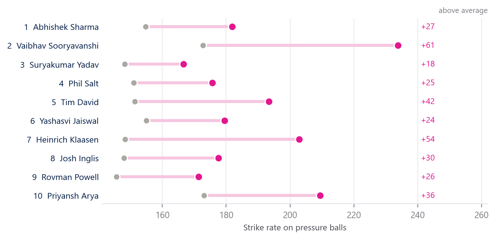
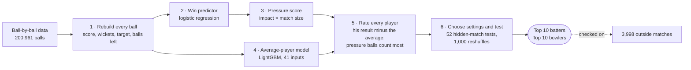
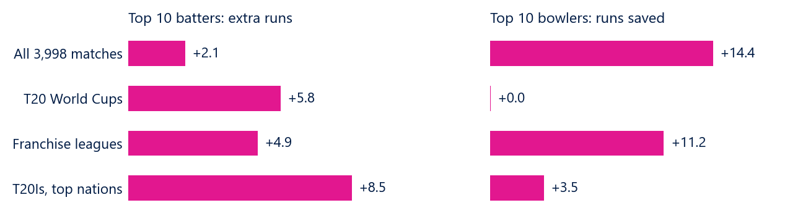

<div align="center">


# Who delivers when it matters?

**Finding the T20 batters and bowlers who perform best under pressure, for Rajasthan Royals.**

Some players are at their best when one ball can decide the match. This project finds them, ball by ball.
It scores every ball by how much it could change the result, compares each player with an average player
in exactly the same situation, and tests the picks on matches the model never saw.

### [My top 10s ↓](#my-top-10s) · [What is pressure? ↓](#what-is-pressure) · [Every idea tested ↓](#every-idea-i-tested-and-what-happened) · [Technical report →](docs/win_probability_model.md)


[The short version](#the-short-version) · [Top 10s](#my-top-10s) · [Pressure](#what-is-pressure) · [How it works](#how-it-works) ·
[Models](#the-models-inside) · [The brief](#the-brief-item-by-item) · [Does it hold up?](#does-it-hold-up) ·
[Every idea tested](#every-idea-i-tested-and-what-happened) · [Batting styles](#what-i-learned-about-batting-styles) ·
[Where it could be wrong](#where-it-could-be-wrong) · [How it was built](docs/how_it_was_built.md) · [Run it](#run-it-yourself)

<sub>Built for <b>SupeRR Selector Season 2 · Round 1</b> (Rajasthan Royals). Bishal Roy · <a href="mailto:roybishal9989@gmail.com">roybishal9989@gmail.com</a></sub>

</div>

---

## The short version

- **The question.** Which batters and bowlers perform best when the match is on the line? The brief asks for a top 10 of each, for Rajasthan Royals' IPL 2027 auction.
- **The data.** Ball-by-ball records of the IPL and T20 internationals from 2022 to 2026: 867 matches and 200,961 balls. I used the corrected file the organisers issued on 16 Nov 2026 ([what changed](#update-16-nov-2026-the-corrected-data-file)). For testing only, I also used 3,998 public matches from [Cricsheet](https://cricsheet.org).
- **The idea.** A ball is under pressure when its result can change who wins. I score every ball for that, then ask, for every player: on those balls, did he do better than an average player would have, in exactly the same situation?
- **What the checks say.** In 52 tests on hidden matches, my top 10 batters beat an average batter 52 times, and my top 10 bowlers saved runs 50 times. Both top 10s also did better than average in 3,998 outside matches.
- **Why these lists.** I tested 14 other ideas, from stacking models to grouping batters into anchors and hitters. None predicted unseen matches better and changed the picks, so the lists stayed. Where a simpler method matched or beat mine, I say so.

## Update, 16 Nov 2026: the corrected data file

The organisers issued a corrected ball-by-ball file on 16 Nov 2026. The only real change is in the extras. The first file stored
only *which kind* of extra was bowled, so every extra counted as 1 run. The corrected file stores the **real extra runs**: a wide
that reaches the boundary is 5, and four byes are 4. Nothing else changed: the same 867 matches and the same balls.

| Check | First file | Corrected file |
|---|---:|---:|
| Rebuilt winning margins that match the official result | 31.7% | **99.0%** |
| Innings totals that match Cricsheet | 50.6% | **94.9%** |
| Chases won by the chasing side even though the rebuilt score fell short of the target | 106 of 807 | **0** |
| Win-chance model error on matches it never saw (chases, log-loss) | 0.3935 | **0.3900** |

I re-ran everything on the corrected file and reviewed every step of the code. The review found three small errors. I tested four
fixes for them as challengers, with the rule written down first ([notebook 28](notebooks/28_final_review_corrected_data.ipynb)).
- **Adopted (ties on the outside matches):**
  - players are now pulled towards the *real* average, not zero;
  - a batter is charged when he is out off a wide.
- **Not adopted:** a fix to the expected value of each ball outcome, because it was worse on the hidden-match tests.

The re-run also fixed a step-order bug: the step that matches outside matches to RR's own (by innings totals) now runs after the totals are rebuilt, so 3,998 outside matches are used (3,993 before). The outside-match figures moved by a few runs; the lists did not.

The stage-by-stage settings search also drifted on the new file: to "runs added" for batters, and to a different bowler setup. Both
lost head-to-head tests against the setups I had tested, so those stay, and are written in full in `config.yaml`.

**Result: both top 10s have the same names as before.** Only the order changed a little.

## My top 10s

<table>
<tr>
<td width="50%" valign="top">

**Batters** · strike rate on pressure balls

| # | Batter | Under pressure | Average player | Stays top 10* |
|---:|---|---:|---:|---:|
| 1 | Abhishek Sharma | **182** | 155 | 98% |
| 2 | Vaibhav Sooryavanshi | **234** | 173 | 88% |
| 3 | Suryakumar Yadav | **167** | 148 | 92% |
| 4 | Phil Salt | **176** | 151 | 78% |
| 5 | Tim David | **193** | 151 | 69% |
| 6 | Yashasvi Jaiswal | **179** | 155 | 78% |
| 7 | Heinrich Klaasen | **203** | 148 | 72% |
| 8 | Josh Inglis | **178** | 148 | 55% |
| 9 | Rovman Powell | **171** | 146 | 40% |
| 10 | Priyansh Arya | **209** | 173 | 34% |

</td>
<td width="50%" valign="top">

**Bowlers** · economy on pressure balls (lower is better)

| # | Bowler | Under pressure | Average player | Stays top 10* |
|---:|---|---:|---:|---:|
| 1 | Jasprit Bumrah | **8.16** | 9.84 | 92% |
| 2 | Lungi Ngidi | **8.93** | 9.85 | 60% |
| 3 | Rashid Khan | **7.54** | 8.48 | 72% |
| 4 | Mitchell Santner | **7.22** | 8.38 | 69% |
| 5 | Benjamin Sears | **10.00** | 9.91 | 55% |
| 6 | Josh Hazlewood | **8.88** | 9.64 | 64% |
| 7 | Sunil Narine | **7.17** | 8.72 | 62% |
| 8 | Nathan Ellis | **8.85** | 9.96 | 47% |
| 9 | Jamie Overton | **8.49** | 9.20 | 31% |
| 10 | Brydon Carse | **9.89** | 8.63 | 28% |

</td>
</tr>
<tr>
<td></td>
<td></td>
</tr>
</table>

**"Average"** is what an average player did in exactly the same situations: same over, score, wickets, target, ground, season and competition. For bowlers it means the same type (pace or spin).
\* **Stays top 10:** I rebuilt the ranking 1,000 times on reshuffled matches. This is how often the player stayed in the top 10, so it shows how sure I am about each pick.

The order comes from the full rating: runs, wickets and how much each ball mattered. It does not come from these two columns alone. Sears gives away runs at about the average rate and Carse at 1.3 an over more, for example, but they take a wicket every 13–14 and 18 pressure balls.

## What is pressure?

> **In plain words:** a ball is under pressure when its result can change who wins the match. A dot ball in the first over hardly matters. A dot ball when 12 are needed off the last over can decide the game.

<div align="center">


<sub>2023 IPL final, cut to 15 overs by rain. Chennai needed 13 off the last over. Single balls moved their chance of winning from 76% down to 14% and then up to 100%.</sub>
</div>

Every ball gets a pressure score in three steps:

| Step | What happens | In numbers |
|---|---|---|
| **1. Chance of winning** | Before every ball, a machine-learning model works out each team's chance of winning from the score, balls left, wickets and target. It works like the win predictor on TV. | |
| **2. How much can this ball change it?** | I check what the chance would become after a dot, a single, a four, a six or a wicket. The bigger the possible swing, the more the ball matters. I call this the ball's **impact**. | First over of a chase: about 1.6%. Last over of a close chase: about 25% on an average ball. |
| **3. How big is the match?** | Finals and knockouts count more than normal games. | Knockout ×1.5 · must-win ×1.25 · normal ×1 · dead rubber ×0.75 |

**Pressure = impact × how big the match is.** I give all 200,961 balls this score and sort them from highest to lowest. The top 20% (about 40,000 balls) are the **pressure balls**. They are not the first balls of a match; they can come at any point. The tight 2023 final had 115 of them, while 129 one-sided matches had none.

**Why this definition?** I didn't pick it on gut feeling.
- I listed 38 possible signs of pressure, such as a required rate above 10, three dots in a row, a new batter or a knockout game.
- Each one had to pass three tests: do players perform differently on those balls, do those balls decide matches, and is it true every season?
- The ideas that passed were built into 8 full definitions, including two from published research, and scored against each other. Impact won.

**Proof that pressure balls are different.**
- On pressure balls, the chance of winning moves 2.2 times as much as on an average ball.
- Batters get out 7% more often than on other balls at the same stage of an innings.

<div align="center">


<sub>Where pressure is highest, in each innings. Each square is one situation, such as "over 17, 4 wickets down". Darker pink means more pressure, on the same scale for both. Batting first, pressure is lighter and spread out; chasing, it is darker wherever the chase can still go either way.</sub>
</div>

**Why do 9 in 10 pressure balls come in chases?** In a chase both teams know the target, so every run and every wicket changes the result directly. Batting first, nobody knows yet what a winning score is. This is not a quirk of my model. I checked 3,998 other T20 matches: T20 internationals including 3 World Cups, franchise leagues like the Big Bash, PSL and SA20, and India's Syed Mushtaq Ali Trophy (full list under [Does it hold up?](#does-it-hold-up)). In every one of them, 82% to 95% of pressure balls came in chases. First-innings balls still count, because every ball counts in the rating and a higher-pressure ball just counts more. Overall, first-innings balls make up about 40% of the ratings.

## How it works



| Step | In plain words | Technique | Notebook |
|---|---|---|---|
| **1. Rebuild every ball** | I added the extra runs (the corrected file of 16 Nov 2026 records them in full) and rebuilt the score, wickets, target and balls left before every ball. | Data cleaning and checks | [01](notebooks/01_clean_the_data.ipynb), [02](notebooks/02_rebuild_every_ball.ipynb) |
| **2. Predict who wins** | The chance of winning before every ball, for both innings. | Logistic regression, chosen over 10 other models | [04](notebooks/04_win_chance_and_average_player.ipynb), [05](notebooks/05_why_logistic_regression_won.ipynb) |
| **3. Score the pressure** | Impact × how big the match is. The top 20% are pressure balls. | 38 signals, 3 tests, 8 definitions compared | [06](notebooks/06_pressure.ipynb) |
| **4. Learn what an average player does** | What an average player does in each situation: how often a dot, a single, a four, a six or a wicket. It never sees player names. | LightGBM (gradient boosting), 41 inputs | [04](notebooks/04_win_chance_and_average_player.ipynb) |
| **5. Rate every player** | On every ball: the player's result minus the average player's, with pressure balls counting most. Players with few balls are pulled towards average. | Empirical Bayes shrinkage | [07](notebooks/07_value_of_every_ball.ipynb), [08](notebooks/08_rating_models.ipynb) |
| **6. Choose the settings and test** | Settings chosen by hiding matches and checking the picks on them. Then the ranking was rebuilt 1,000 times, and the picks were tested on 3,998 outside matches. | Cross-validation, bootstrap, outside test | [11](notebooks/11_choose_settings.ipynb), [12](notebooks/12_final_rankings.ipynb), [13](notebooks/13_robustness.ipynb), [14](notebooks/14_outside_test.ipynb) |

**Why not compare a player with his own normal game?** The brief talks about players' usual levels, so I tested this first.
- For every player I measured pressure performance minus normal performance. Then I split his matches into two halves.
- Players who rose under pressure in one half did not do it again in the other. And when I picked "pressure balls" at random, players looked just as different.
- Rising above your own level looks like luck. So the ranking compares each player with everyone else in the same pressure moments, and that does repeat.

## The models inside

Machine learning is used to work out what is normal in each situation. It never picks a player directly.

| Model | Its job | Why this one |
|---|---|---|
| **Logistic regression** (curves on the game state) | Chance of winning before every ball | I tested 11 models for this job: decision tree, random forest, extra trees, XGBoost, LightGBM, CatBoost, k-nearest neighbours, two stacked ensembles, an average of models, and logistic regression. On matches it had not seen, the simple model predicted best and was the best calibrated. |
| **LightGBM** (gradient boosting) | The average player: chance of each outcome on every ball | It has many situation inputs to combine, and 200,961 balls to learn from. It never sees player names, so it describes the situation, not the player. |
| **Empirical Bayes** | Fair ratings for players with few balls | A player with 60 pressure balls is trusted less than one with 500, so his rating is pulled towards average. |
| **Bootstrap** (1,000 rebuilds) | How sure each pick is | Gives the "stays top 10" figure for every player. |
| **Semi-supervised roles, clustering** | Labels such as opener, finisher, death bowler | Used only for labels and checks, never to rank. |

<details>
<summary><b>How to read the error numbers</b> (log-loss, lower is better, not a percentage)</summary>

### How to read the error numbers

The models are scored with **log-loss**. It is **not a percentage**: an error of 1.578 does not mean "158% wrong".

- **How it works.** For every ball, a model gives a chance to each possible result. Log-loss looks only at the chance it gave to what **actually happened**:
  - if it gave that result a 50% chance, the ball costs 0.69;
  - at 30%, it costs 1.20;
  - at 10%, it costs 2.30.
- **The score** is the average over all balls. Lower is better.
- **Why not zero?** Zero would mean the model was 100% sure and always right. That is impossible in cricket, because even the best bowler gets hit for four. So judge the score against simple baselines, not against zero:

| Average-player model (8 possible results per ball) | Log-loss |
|---|---:|
| Blind guess: 12.5% for each result | 2.079 |
| Only the overall rates (30% dots, 36% singles, and so on) | 1.637 |
| **LightGBM (used)** | **1.578** |

| Win-chance model (2 possible results: win or lose) | Log-loss |
|---|---:|
| Coin toss: 50% each | 0.693 |
| **Logistic regression (used), chases** | **0.390** |

- **Don't compare the two tables with each other.** One model picks between 8 results, the other between 2.
- **A simpler check is whether the predicted rates are right.** The average-player model predicts dots 30.24% of the time; they actually happen 30.21% of the time. For wickets it is 5.44% against 5.41%.

</details>

<details>
<summary><b>Why the simple model wins one job and LightGBM wins the other</b></summary>

### Why the simple model wins one job and LightGBM wins the other

| | Win chance | Average player |
|---|---|---|
| **What is predicted** | Who wins the match | What happens on this ball |
| **Independent answers** | About 820 in the chases: all balls of a match share one result | 200,961: every ball has its own result |
| **Can a model memorise?** | Yes. The match details (target, ground, season, team strength) are the same for every ball of a match, and together they are unique to that match, like a fingerprint. | No. One match has many different results, so there is nothing per match to memorise. |
| **What happened** | Tree models learned "this fingerprint → this team won". Given only the match details, LightGBM scored 0.0001 on matches it had seen, a perfect memory, but 1.95 on new matches: far worse than a coin toss (0.69). | LightGBM learned real patterns, such as how a new batter plays at 4 down at the death against pace. |
| **Winner on new matches** | **Logistic regression: 0.391** against 0.395 for the best tree model or stack (XGBoost) | **LightGBM: 1.578** against 1.594 for logistic regression |

The lesson: the right model depends on how many **independent** answers there are, not on how many rows. Logistic regression cannot memorise a fingerprint. It can only learn smooth rules ("more runs needed per ball means a lower chance of winning"), and those carry over to new matches.

<div align="center">


<sub>Why the simple model won. The tree models did very well on matches they trained on (open circles) but worse on new matches (filled dots): they memorised. Full story in the <a href="docs/win_probability_model.md">technical report</a>.</sub>
</div>

</details>

## The brief, item by item

| The brief asks for | What I did |
|---|---|
| **Pressure definition** | Impact (how much one ball can change the chance of winning) × how big the match is. The top 20% of balls are pressure balls. I chose it over 7 other definitions by testing. |
| **Performance measurement** | Every ball is compared with an average player in exactly the same situation. Batters gain runs and lose what a dismissal costs. Bowlers gain runs saved and their own wickets, and lose wides and no-balls. Pressure balls count most. |
| **Fair comparisons** | **Sample sizes:** few balls means the rating is pulled towards average, and at least 60 pressure balls are needed. **Eligibility:** the lists only include players active in 2025 or 2026. **Match contexts:** same ground, season, competition and stage, and bowlers only against their own type (this took spinners in the top 10 from 9 to 3). **IPL and T20I data:** both are used, each competition level with its own average player. |
| **Evidence for the top 10** | Every pick beat an average player under pressure. In 52 tests on hidden matches, my top 10 batters beat an average batter 52 times and my top 10 bowlers saved runs 50 times. |
| **Reliability and limitations** | 1,000 rebuilds of the ranking (checked again with separate code), 3,998 outside matches, 14 "what if" tests, and an honest list of limits (below). |

## Does it hold up?

Three separate checks, each answering a different question.

**Check 1: does it work on matches it has not seen?** I hid part of the matches, built the ranking on the rest, and checked the hidden matches. I repeated this 52 times.
- My top 10 batters beat an average batter in **52 of 52** tests, by about 11 runs per 100 pressure balls.
- My top 10 bowlers saved runs in **50 of 52** tests, about 7 runs per 100 pressure balls.

**Check 2: how sure is each pick?** I rebuilt the whole ranking 1,000 times on reshuffled matches and counted how often each player stayed in the top 10 (the "Stays top 10" column above). To make sure that count has no bug, I rebuilt it again from scratch with different code and a different random seed ([notebook 23](notebooks/23_bootstrap_audit.ipynb), run on the first data file): 36 of 40 players matched within normal random wobble, the average difference was +0.2 points, and no "close call" label changed.

**Check 3: does it work in other cricket?** I took every men's T20 match from 2022 to 2026 on Cricsheet in these competitions:
- T20 internationals, including 3 World Cups;
- the Vitality Blast, Big Bash, BPL, PSL, CPL, ILT20, SA20, MLC and LPL;
- the Syed Mushtaq Ali Trophy.

Matches also in the supplied data were removed, so nothing counts twice.

<div align="center">


<sub><b>How to read it:</b> +14.4 means that over 100 pressure balls, my top 10 bowlers gave away about 14 fewer runs than an average bowler in the same situations would have. In T20 World Cups, a small sample, my bowling top 10 was level with average.</sub>
</div>

> **Where a simpler method did better.**
> - On the outside matches, picking batters by raw strike rate under pressure gave a better top 10 than mine.
> - For bowlers, a top 10 picked from all balls (not just pressure balls) saved slightly more runs: 15.8 against my 14.4. My ranking still put the whole pool of bowlers in a better order.
> - In the 52 tests on the supplied data, my batting top 10 added 11.1 extra runs per 100 pressure balls against 2.4 for a raw strike rate top 10, and did better in 46 of the 52. I report all of these.

> **A fair contest for the batting ranking.** My settings were tuned on the 52 hidden-match tests, so on those tests the
> current method always had a head start over any new idea. The outside matches were never used to tune anything, so
> there every method starts equal. The score below is how well each method put the batters in the right order
> (0 = no link, higher is better), averaged over two yardsticks: win chance added and runs added on pressure balls.
> ([notebook 26](notebooks/26_fair_contest_outside_matches.ipynb); this table was run on the first data file. On the corrected
> file my ranking scores 0.117 on all outside matches; see [notebook 28](notebooks/28_final_review_corrected_data.ipynb).)

| Batting ranking method | All 3,993 outside matches | T20 World Cups | Franchise leagues | Full-member T20Is |
|---|---:|---:|---:|---:|
| **Mine (submitted)** | **0.120** | 0.239 | 0.087 | 0.237 |
| Compare batters only within the same playing style | 0.122 | 0.160 | 0.118 | 0.034 |
| Raw strike rate under pressure | 0.122 | 0.026 | 0.160 | 0.106 |
| Compare batters only within the same job | 0.118 | 0.248 | 0.084 | 0.227 |
| Compare batters only within the same batting position | 0.114 | 0.248 | 0.081 | 0.222 |
| Overall level, ignoring pressure | −0.007 | 0.178 | −0.052 | 0.261 |

- **Overall it is a tie.** No method beats mine with any confidence, and mine does not clearly beat the two simpler ones either. Only the batting-position version is clearly worse.
- **Mine is the most consistent.** It is never poor in any kind of cricket. The style and strike-rate methods do well in franchise leagues but badly in internationals.
- **So the honest summary is "not beaten", not "proven best".**

## Every idea I tested, and what happened

After the lists were built, I kept asking "what if?", and so did the people who reviewed them. Each idea got a fair test:
the rule for "better" was written down **before** running, and an idea replaced the method only if it predicted unseen
matches at least as well **and** changed the picks.

**Choices made while building the method**

| The question | What I tried | What happened | Decision | Notebook |
|---|---|---|---|---|
| Which model should predict who wins? | 11 models, from decision trees to stacked ensembles | The tree models memorised matches; simple logistic regression was best on new ones | Logistic regression | [05](notebooks/05_why_logistic_regression_won.ipynb) |
| What counts as pressure? | 38 signs of pressure, 3 tests each, 8 full definitions | Impact × how big the match is scored best | Used | [06](notebooks/06_pressure.ipynb) |
| Should a player be judged against his own usual level? | Pressure performance minus normal performance | Players who rose under pressure in one half of their matches did not do it again in the other: it looks like luck | Dropped | [08](notebooks/08_rating_models.ipynb) |
| Should bowlers be compared only with their own type? | Pace v pace, spin v spin | Without it, 9 of the top 10 were spinners; with it, 3 | Used | [04](notebooks/04_win_chance_and_average_player.ipynb) |

**Challenges after the lists were built** (notebooks 17 to 27 were run on the first data file, before the 16 Nov correction;
notebook 28 re-checks the method on the corrected file)

| The question | What I tried | What happened | Decision | Notebook |
|---|---|---|---|---|
| Does the corrected data file (16 Nov) change anything? | Re-ran everything; reviewed every step; tested 4 fixes, the batting value and the bowler setup head to head | The same 10 names in both lists. Shrinking towards the real average and charging dismissals off a wide tie on outside matches, so they were adopted. The value fix lost on hidden matches. The search's new batting value (0.097 v 0.117 outside) and bowler setup (0.245 v 0.302) both lost | Lists unchanged | [28](notebooks/28_final_review_corrected_data.ipynb) |
| Does one big match carry a pick? | Penalise picks that lean on a single match | Worse in 24 of the 38 tests where it changed anything | Not used | [18](notebooks/18_one_match_check_and_deck_numbers.ipynb) |
| Should running between the wickets get its own credit? | 1s, 2s and 3s against an average batter, as a fourth part of the batting score | It is a real, repeatable skill, but the same 10 batters came out and hidden matches were not predicted better | Not added | [19](notebooks/19_strike_rotation_test.ipynb) |
| Would many more batting details do better? | About 250 features (yorkers, slower balls, collapses, big chases, shot choice and more) with feature selection | Best feature model 0.134 against 0.143 for the rating, and worse one season ahead | Not used | [20](notebooks/20_batting_features_round1.ipynb), [21](notebooks/21_batting_features_round2.ipynb) |
| Would stacking models improve the average player? | LightGBM, XGBoost and CatBoost, combined six ways | 0.08% less error, the same 10 batters, no better on hidden matches (0.142 against 0.143) | Single LightGBM stays | [17](notebooks/17_research_more_data_and_stacking.ipynb), [22](notebooks/22_stacking_average_player.ipynb) |
| Would more data help? | Adding about 5 lakh outside balls | Helps on outside matches, barely on RR's own (0.002); batter ratings no better | Not used | [17](notebooks/17_research_more_data_and_stacking.ipynb) |
| Are the "stays top 10" numbers right? | Rebuilt from scratch with different code | No fault found | Numbers stand | [23](notebooks/23_bootstrap_audit.ipynb) |
| Should batters be compared only within their batting position, like pace v spin? | Openers v openers, No. 3-4 v No. 3-4, and so on | No position gets an unfair boost; the same 10 batters; slightly worse (0.137) | Not used | [24](notebooks/24_batting_position_test.ipynb) |
| Should batters be compared only within their job and style (anchor, accelerator, hitter)? | Job from how they are used; style from their normal balls | Style labels are unstable (only 42% of players keep theirs between two halves of their matches); the top 10 got weaker; 0.126 overall | Not used; kept as a squad-planning view (below) | [25](notebooks/25_batting_roles_and_styles.ipynb) |
| Does the method only win because it was tuned on the tests? | A fair contest on the outside matches, where nothing was tuned | A tie overall; mine is the most consistent across kinds of cricket | Stays, as "not beaten" | [26](notebooks/26_fair_contest_outside_matches.ipynb) |
| Are there hidden batting types I am missing? | Features first, then 7 clustering methods, each tested against data with no groups | No types exist; style is a set of sliding scales | Nothing to compare within | [27](notebooks/27_hidden_batting_types.ipynb) |

The scores in this table (0.143, 0.137 and so on) measure how well a method put batters in the right order on hidden
matches: 0 means no link, higher is better. They come from the first data file; on the corrected file the submitted batting
rating scores 0.128 on the same tests (notebook 28).

### Why the lists stayed the same

- **Every idea had a fair chance.** The rule was fixed before each test, and the numbers are reported whichever way they went.
- **None did both things needed to replace the method:** predict unseen matches at least as well, and change the picks. Most picked the same 10 names anyway.
- **I checked my own bias.** The method was tuned on the 52 hidden-match tests, which gives it a head start there. On the outside matches, where nothing was tuned, it ties with the simpler options overall and is the most consistent. That is why I call it "not beaten" rather than "the best possible".
- **Where a simpler method beat it, I say so** (raw strike rate's batting top 10 on outside matches; bowlers picked from all balls).

<details>
<summary><b>Detail: stacking and more data</b> (first data file)</summary>

**1. Stacking the average-player model.** Several models were combined, and each was judged on RR's hidden matches. The error is log-loss: lower is better, and it is not a percentage.

| Average-player model | Error on hidden matches |
|---|---:|
| No model (overall frequencies only) | 1.637 |
| Logistic regression | 1.594 |
| ExtraTrees | 1.581 |
| XGBoost | 1.578 |
| **LightGBM (used)** | **1.578** |
| Average of LightGBM and XGBoost | 1.578 |
| Stacking all four, with a logistic regression on top | 1.577 |

Stacking is better by 0.0007, about 1% of what LightGBM already gains over no model. It is not worth the extra complexity.

**2. More data for the average player.** The model learned from RR's 2 lakh balls plus about 5 lakh outside balls, and was tested on the other 4 lakh outside balls.

| Tested on | RR data only | RR + outside data |
|---|---:|---:|
| Outside matches | 1.565 | **1.547** |
| RR's own hidden matches | 1.578 | **1.576** |

- **On outside matches, it helps a lot.** This is expected, because half of the outside matches are T20Is between associate nations, a different kind of cricket.
- **On RR's own IPL and T20I matches, it barely helps** (0.002).

**3. More data for batter ratings.** Batters were rated on RR's data plus outside matches, then checked on other outside matches. I ran 6 tests: 5 random splits and 1 forward in time (learn 2022 to 2024, test 2025 to 2026). "Order" below is the rank correlation between the rating and what happened: 0 means no link, 1 means a perfect match.

| Rating built on | Order of all batters (average) | Top 10, extra runs per 100 pressure balls (average, range) |
|---|---:|---:|
| RR data only | 0.051 | +3.5 (−4.8 to +11.1) |
| RR + outside data | 0.060 | −1.0 (−9.9 to +9.5) |
| Outside data only | −0.013 | −0.5 |

- **No clear gain.** The order of all batters got slightly better, but the top 10 got slightly worse.
- **The differences are noise.** Both are much smaller than the swing from one test to the next, and the forward-in-time test got worse.
- **A warning case.** With all outside matches added, the #1 batter would be a county player with 0 pressure balls in RR's data; all 158 of his came in England's Vitality Blast.

**Verdict.** The main method stays as it is. More data helps only when it comes from the same kind of cricket.

</details>

<details>
<summary><b>Detail: batting position, job and style, on the 52 hidden-match tests</b> (first data file)</summary>

| Batting ranking | Score on hidden matches | Next-season checks | Top 10: extra runs per 100 pressure balls | Same 10 names as submitted |
|---|---:|---:|---:|---:|
| **Mine (submitted)** | **0.143** | **0.150** | **11.7** | 10 |
| Within batting position | 0.137 | 0.139 | 11.5 | 10 |
| Within position and phase | 0.137 | 0.140 | 10.9 | 10 |
| Within job | 0.137 | 0.140 | 11.1 | 10 |
| Within style | 0.126 | 0.111 | 9.6 | 8 |
| Within job and style | 0.124 | 0.116 | 9.4 | 7 |

Within style was the one result that went the other way: on the random half-and-half tests it put the whole pool in a
slightly better order (better in 35 of 50). But its top 10 added fewer runs and it was worse one season ahead.

</details>

## What I learned about batting styles

**There are no hidden batting "types".** I chose the features first and then the method ([notebook 27](notebooks/27_hidden_batting_types.ipynb); this section was run on the first data file, and the ranks in brackets below are from the ranking submitted on 14 Nov):

| Step | What I did | What came out |
|---|---|---|
| 1. Features | 22 possible style features: scoring shape, how fast a batter starts, shot choice, results against spin, short balls and slower balls, and more | |
| 2. Feature selection | Kept only stable traits (similar in two halves of a player's matches), removed the effect of his batting job, dropped near-duplicates | 13 kept. Shot choice is the most stable trait. "Speeding up later in the innings", the anchor's trademark, is not a repeatable trait at all |
| 3. Seven clustering methods | k-means, Ward, spectral, Gaussian mixture, Bayesian mixture, HDBSCAN, UMAP + HDBSCAN | |
| 4. A fair test | Each method had to beat 50 copies of the data that have no groups, and find the same groups in two halves of the matches | Batting **jobs** (opener, finisher...) passed easily, so the test works. Playing **styles** failed with all 7 methods |

**Style is a set of sliding scales.** Three of them explain 64% of the differences between batters:

| Sliding scale | One end ↔ the other | Where my top 10 sit |
|---|---|---|
| 1. Attacker ↔ accumulator | Boundaries, fast starts, sixes ↔ nudges, singles, defence | 9 of 10 among the top 15% of attackers (Powell is the exception) |
| 2. Dot-tolerant ↔ always scoring | Many dots early, then sweeps and slogs ↔ scores from the first ball | Powell, Suryakumar and Jaiswal lean dot-tolerant |
| 3. Classical ↔ unorthodox | Drives, off side ↔ sweeps, scoops | Suryakumar, Sooryavanshi and Inglis are the most unorthodox |

My batting list leans heavily towards attackers. Is that a bias? The fair contest says no: raw strike rate, which leans
even harder that way, did no better overall on the outside matches.

**A squad-planning view (not used to rank).** The best pressure batter in each job and style, with his place in my full
ranking ([notebook 25](notebooks/25_batting_roles_and_styles.ipynb)). Style here comes from normal balls, against an
average batter in the same situation: an accelerator hits more boundaries and plays fewer dots, a hitter hits more
boundaries but plays more dots, an anchor hits fewer boundaries but keeps the strike moving.

| Job | Accelerator | Hitter | Anchor |
|---|---|---|---|
| **Opener** | Abhishek Sharma (1) | Yashasvi Jaiswal (6) | Reeza Hendricks (19), then Shubman Gill, Virat Kohli |
| **Top order (No. 3-4)** | Suryakumar Yadav (2) | Nicholas Pooran (11) | Cameron Green (18) |
| **Middle order (No. 5-6)** | Rinku Singh (14) | Rovman Powell (8) | Heinrich Klaasen (7)* |
| **Finisher** | Tim David (5) | Andre Russell (21) | Washington Sundar (66) |

<sub>* Klaasen's label is borderline: his boundary rate is exactly average for where he bats. Style labels move a lot from season to season, so treat this table as a guide, not a verdict.</sub>

## Where it could be wrong

- **Batters are hard to judge from one season.**
  - Only about 4% of the difference between batters in one season is skill; the rest is luck.
  - A batter needs about 1,100 pressure balls before skill and luck count equally in his numbers.
  - That's why I used all five seasons, and why the batting list did not hold up on 2026 alone.
- **On outside cricket, my batting ranking only ties with simpler methods.** It is the most consistent across kinds of cricket, but in franchise leagues the simpler methods looked better (that check came after seeing the results, so it may be chance).
- **The bowling list leans on T20Is.** Built on IPL matches alone, only 4 of the 10 bowlers would stay.
- **The first innings is harder to read.** My pressure score is less accurate in the first innings: no win-chance model reached my own target there.
- **Some things are missing from the data.** There is no fielding, dropped-catch, pitch or weather data.
- **Some picks rest on fewer balls.** Arya, Carse and Overton have the smallest samples, and Powell, Arya, Ellis, Overton and Carse stay in the top 10 in under half of the 1,000 rebuilds.
- **Two bowlers are picked for wickets, not economy.** Sears gives away runs at about the average rate under pressure and Carse 1.3 an over more; their wickets carry them.
- **The ranking settings were fixed by review, not only by the search.** The stage-by-stage search drifted on the corrected file; both final setups won head-to-head tests and are written in full in `config.yaml`, with the evidence.
- **2026 is not a perfectly clean test.** I looked at it more than once while building.
- **Anchors cannot be judged as a separate group.** Their trademark, speeding up later in the innings, does not repeat from one set of matches to the next in this data.
- **The lists are fairly stable.** Changing one choice at a time usually keeps 8 of the 10 names.

## Run it yourself

<details>
<summary><b>Repository layout</b></summary>

```
config.yaml                              every threshold, weight, seed and path
requirements.txt
notebooks/
  Building the method
  01_clean_the_data.ipynb                fix extras, super overs, player IDs
  02_rebuild_every_ball.ipynb            the situation before every ball
  03_outside_matches.ipynb               Cricsheet matches, used only for testing
  04_win_chance_and_average_player.ipynb win-chance and average-player models
  05_why_logistic_regression_won.ipynb   11-model comparison, memorisation test
  06_pressure.ipynb                      38 signals, 3 tests, 8 definitions
  07_value_of_every_ball.ipynb           player minus average, on every ball
  08_rating_models.ipynb                 rating methods, the "own usual level" test
  09_roles_and_clusters.ipynb            role labels (never used to rank)
  10_feature_checks.ipynb                which situation facts matter
  11a_settings_test_setup.ipynb          the 52 hidden-match tests
  11_choose_settings.ipynb               settings chosen on those tests
  12_final_rankings.ipynb                final lists, 1,000 rebuilds
  13_robustness.ipynb                    change one thing at a time
  14_outside_test.ipynb                  the 3,998-match exam
  15_rating_method_check.ipynb           evidence for the rating method
  16_figures.ipynb                       charts

  Testing ideas (none changed the lists)
  17_research_more_data_and_stacking.ipynb   more data and a first stacking test
  18_one_match_check_and_deck_numbers.ipynb  does a pick lean on one match?
  19_strike_rotation_test.ipynb              credit for 1s, 2s and 3s
  20_batting_features_round1.ipynb           ~150 batting features + feature selection
  21_batting_features_round2.ipynb           ~250 features, adding groups from published work
  22_stacking_average_player.ipynb           LightGBM v XGBoost, CatBoost and six stacks
  23_bootstrap_audit.ipynb                   the "stays top 10" numbers, rebuilt with separate code
  24_batting_position_test.ipynb             compare batters within batting position
  25_batting_roles_and_styles.ipynb          compare batters within job and style
  26_fair_contest_outside_matches.ipynb      every batting method on the outside matches
  27_hidden_batting_types.ipynb              features first, 7 clustering methods, test against no groups

  The corrected data file (16 Nov 2026)
  28_final_review_corrected_data.ipynb       review fixes, batting value and bowler setup, head to head
external/                                Cricsheet matches, used only for testing (ODC-By, see external/README.md)
rrlib/                                   two small shared helpers the notebooks import
docs/
  how_it_was_built.md                    map of everything tried, kept and dropped
  win_probability_model.md               why the simple model won (technical)
  figures/, images/, results/            charts and result tables (summaries only)
```

</details>

1. **Install** Python 3.12 and the requirements:
   ```bash
   pip install -r requirements.txt
   ```
2. **Add the data.** Put the supplied competition data pack in `6af3166e7b922_data_pack/` at the top of the repository, with the corrected ball-by-ball file issued on 16 Nov 2026 (`6af855c0e8386_ball_by_ball.csv`; the name is set in `config.yaml`, `paths.ball_file`). It is not included here.
3. **The outside matches are included.** `external/cricsheet_raw/` holds the exact Cricsheet downloads used (11 Nov 2026), so the outside-match test can be rebuilt as it was run. Cricsheet updates its files over time; newer downloads from [cricsheet.org/downloads](https://cricsheet.org/downloads/) will add matches.
4. **Run the notebooks in order** from the `notebooks/` folder: 01, 02, 03, then 04 to 16 (these build the lists), then 28. Notebooks 17 to 27 are the tests of other ideas; run them after 16, in any order (22 needs about an hour on a laptop). Their saved outputs come from the first data file.

**Checked (16 Nov 2026, corrected file):** running notebooks 01 to 16 and 28 from scratch gives the same top 10s in the same order, the same top 30s, the same settings, "stays top 10" figures within 0.3 points and outside-match figures within 0.5 runs per 100 pressure balls. The tiny differences come from multi-threaded model fitting (LightGBM sums in a slightly different order from run to run). Before the correction the same check matched byte for byte. Notebook 18 was also re-run on the corrected file. On the first data file, notebooks 19 to 21 and 23 to 27, run from this repository's code, reproduced their result tables byte for byte; notebook 22, run from its saved base-model predictions, reproduced every reported number to 5 decimal places.

Every setting lives in `config.yaml`, and every random step uses a fixed seed. Results are written to `outputs/`, which is not tracked.

## Data policy

- **The competition data is not in this repository**, and nothing built from it at ball level is either. The competition rules do not allow it to be shared. The `.gitignore` is an allow-list, so only code and documents can ever be committed.
- **Cricsheet data** is from [Cricsheet](https://cricsheet.org), under the Open Data Commons Attribution License (ODC-By 1.0). It is included in `external/` so the outside-match test can be reproduced; it was used for testing only, never to build or tune the rankings.
- **The submitted deck is not here.** It contains player photos and team branding.

## Author

**Bishal Roy** · [roybishal9989@gmail.com](mailto:roybishal9989@gmail.com)
