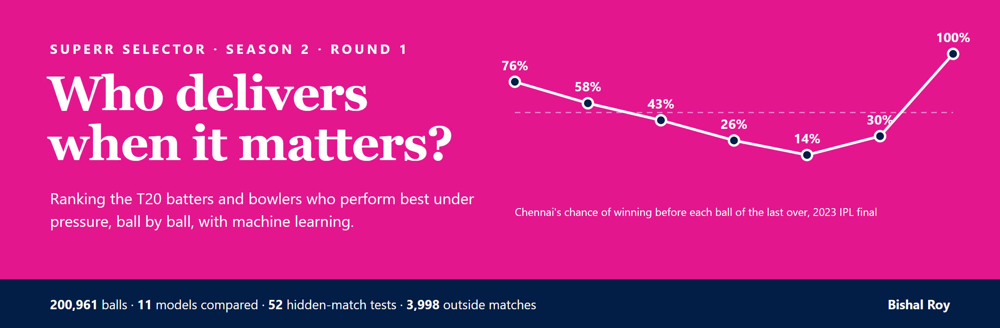
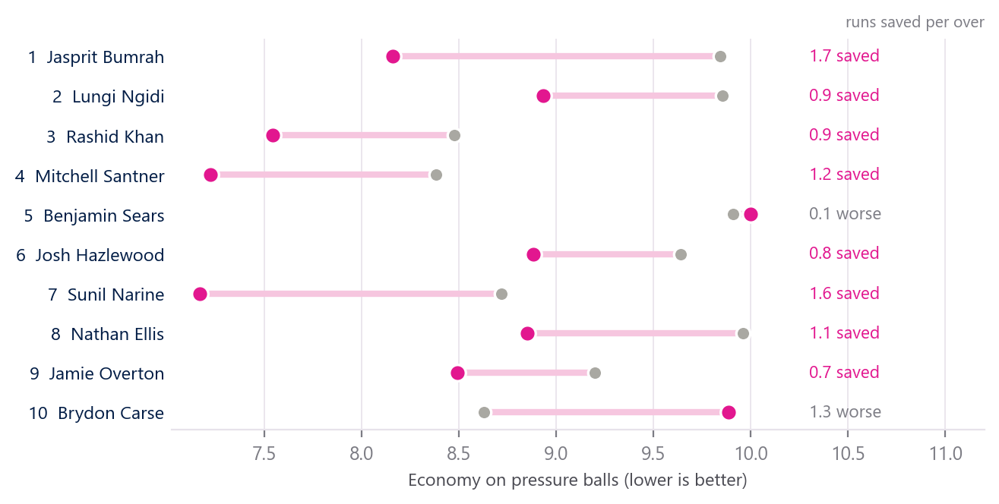
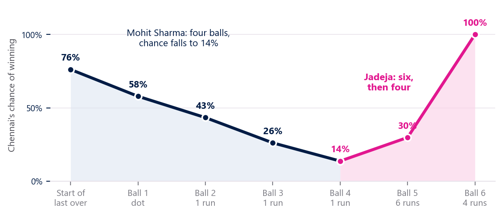
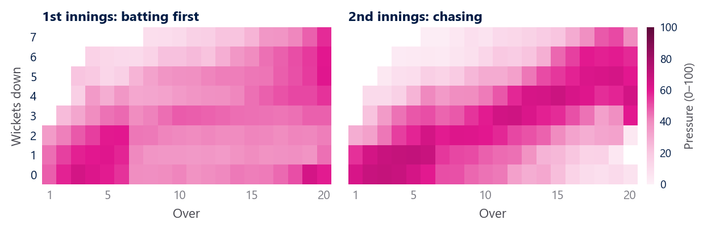
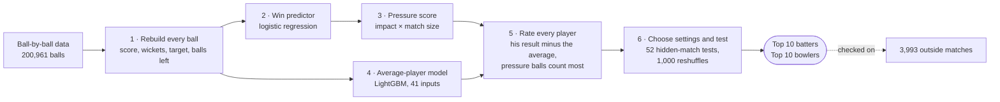
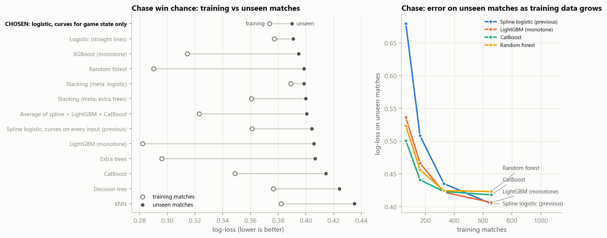

<div align="center">



# Who delivers when it matters?

**Finding the T20 batters and bowlers who perform best under pressure, for Rajasthan Royals.**

Some players are at their best when one ball can decide the match. This project finds them, ball by ball.
It scores every ball by how much it could change the result, compares each player with an average player
in exactly the same situation, and tests the picks on matches the model never saw.

### [My top 10s ↓](#my-top-10s) · [What is pressure? ↓](#what-is-pressure) · [How it works ↓](#how-it-works) · [Technical report →](docs/win_probability_model.md)


[The short version](#the-short-version) · [Top 10s](#my-top-10s) · [Pressure](#what-is-pressure) · [How it works](#how-it-works) ·
[Machine learning](#the-machine-learning-inside) · [The brief, item by item](#the-brief-item-by-item) · [Does it hold up?](#does-it-hold-up) ·
[Extra research](#extra-research-would-stacking-or-more-data-help) · [Where it could be wrong](#where-it-could-be-wrong) · [How it was built](docs/how_it_was_built.md) · [Run it](#run-it-yourself)

<sub>Built for <b>SupeRR Selector Season 2 · Round 1</b> (Rajasthan Royals). Bishal Roy · <a href="mailto:roybishal9989@gmail.com">roybishal9989@gmail.com</a></sub>

</div>

---

## The short version

- **The question.** Which batters and bowlers perform best when the match is on the line? The brief asks for a top 10 of each, for Rajasthan Royals' IPL 2027 auction.
- **The data.** Ball-by-ball records of the IPL and T20 internationals from 2022 to 2026: 867 matches and 200,961 balls. For testing only, I also used 3,993 public matches from [Cricsheet](https://cricsheet.org).
- **The idea.** A ball is under pressure when its result can change who wins. I score every ball for that, then ask, for every player: on those balls, did he do better than an average player would have, in exactly the same situation?
- **The proof.** In 52 tests on hidden matches, my top 10 batters beat an average batter 51 times, and my top 10 bowlers saved runs 50 times. They also did better than average in 3,993 outside matches.

## My top 10s

<table>
<tr>
<td width="50%" valign="top">

**Batters** · strike rate on pressure balls

| # | Batter | Under pressure | Average player | Stays top 10* |
|---:|---|---:|---:|---:|
| 1 | Abhishek Sharma | **184** | 156 | 93% |
| 2 | Suryakumar Yadav | **167** | 149 | 93% |
| 3 | Vaibhav Sooryavanshi | **236** | 176 | 87% |
| 4 | Phil Salt | **176** | 152 | 82% |
| 5 | Tim David | **195** | 152 | 66% |
| 6 | Yashasvi Jaiswal | **180** | 157 | 73% |
| 7 | Heinrich Klaasen | **200** | 152 | 67% |
| 8 | Rovman Powell | **177** | 145 | 56% |
| 9 | Josh Inglis | **164** | 149 | 53% |
| 10 | Priyansh Arya | **202** | 172 | 37% |

</td>
<td width="50%" valign="top">

**Bowlers** · economy on pressure balls (lower is better)

| # | Bowler | Under pressure | Average player | Stays top 10* |
|---:|---|---:|---:|---:|
| 1 | Jasprit Bumrah | **8.20** | 10.03 | 93% |
| 2 | Lungi Ngidi | **8.96** | 9.95 | 64% |
| 3 | Josh Hazlewood | **8.69** | 9.77 | 74% |
| 4 | Benjamin Sears | **9.97** | 10.02 | 61% |
| 5 | Nathan Ellis | **8.42** | 10.05 | 64% |
| 6 | Rashid Khan | **7.41** | 8.53 | 62% |
| 7 | Sunil Narine | **7.10** | 8.77 | 54% |
| 8 | Brydon Carse | **9.00** | 9.08 | 36% |
| 9 | Mitchell Santner | **7.30** | 8.48 | 46% |
| 10 | Jamie Overton | **7.48** | 9.36 | 26% |

</td>
</tr>
<tr>
<td></td>
<td></td>
</tr>
</table>

**"Average"** is what an average player did in exactly the same situations: same over, score, wickets, target, ground, season and competition. For bowlers it means the same type (pace or spin).
\* **Stays top 10:** I rebuilt the ranking 1,000 times on reshuffled matches. This is how often the player stayed in the top 10, so it shows how sure I am about each pick.

The order comes from the full rating: runs, wickets and how much each ball mattered. It does not come from these two columns alone. Sears and Carse, for example, give away runs at about the average rate, but each takes a wicket every 16 pressure balls.

## What is pressure?

> **In plain words:** a ball is under pressure when its result can change who wins the match. A dot ball in the first over hardly matters. A dot ball when 12 are needed off the last over can decide the game.

<div align="center">


<sub>2023 IPL final, cut to 15 overs by rain. Chennai needed 13 off the last over. Single balls moved their chance of winning from 77% down to 6.5% and then up to 100%.</sub>
</div>

Every ball gets a pressure score in three steps:

| Step | What happens | In numbers |
|---|---|---|
| **1. Chance of winning** | Before every ball, a machine-learning model works out each team's chance of winning from the score, balls left, wickets and target. It works like the win predictor on TV. | |
| **2. How much can this ball change it?** | I check what the chance would become after a dot, a single, a four, a six or a wicket. The bigger the possible swing, the more the ball matters. I call this the ball's **impact**. | First over of a chase: about 1.5%. Last over of a close chase: about 24% on an average ball. |
| **3. How big is the match?** | Finals and knockouts count more than normal games. | Knockout ×1.5 · must-win ×1.25 · normal ×1 · dead rubber ×0.75 |

**Pressure = impact × how big the match is.** I give all 200,961 balls this score and sort them from highest to lowest. The top 20% (about 40,000 balls) are the **pressure balls**. They are not the first balls of a match; they can come at any point. The tight 2023 final had 115 of them, while 131 one-sided matches had none.

**Why this definition?** I didn't pick it on gut feeling.
- I listed 38 possible signs of pressure, such as a required rate above 10, three dots in a row, a new batter or a knockout game.
- Each one had to pass three tests: do players perform differently on those balls, do those balls decide matches, and is it true every season?
- The ideas that passed were built into 8 full definitions, including two from published research, and scored against each other. Impact won.

**Proof that pressure balls are different.**
- On pressure balls, the chance of winning moves 2.2 times as much as on an average ball.
- Batters get out 8% more often than on other balls at the same stage of an innings.

<div align="center">


<sub>Where pressure is highest, in each innings. Each square is one situation, such as "over 17, 4 wickets down". Darker pink means more pressure, on the same scale for both. Batting first, pressure is lighter and spread out; chasing, it is darker wherever the chase can still go either way.</sub>
</div>

**Why do 9 in 10 pressure balls come in chases?** In a chase both teams know the target, so every run and every wicket changes the result directly. Batting first, nobody knows yet what a winning score is. This is not a quirk of my model. I checked 3,993 other T20 matches: T20 internationals including 3 World Cups, franchise leagues like the Big Bash, PSL and SA20, and India's Syed Mushtaq Ali Trophy (full list under [Does it hold up?](#does-it-hold-up)). In every one of them, 80% to 92% of pressure balls came in chases. First-innings balls still count, because every ball counts in the rating and a higher-pressure ball just counts more. Overall, first-innings balls make up about 41% of the ratings.

## How it works



| Step | In plain words | Technique | Notebook |
|---|---|---|---|
| **1. Rebuild every ball** | I fixed how extras are recorded and rebuilt the score, wickets, target and balls left before every ball. | Data cleaning and checks | [01](notebooks/01_clean_the_data.ipynb), [02](notebooks/02_rebuild_every_ball.ipynb) |
| **2. Predict who wins** | The chance of winning before every ball, for both innings. | Logistic regression, chosen over 10 other models | [04](notebooks/04_win_chance_and_average_player.ipynb), [05](notebooks/05_why_logistic_regression_won.ipynb) |
| **3. Score the pressure** | Impact × how big the match is. The top 20% are pressure balls. | 38 signals, 3 tests, 8 definitions compared | [06](notebooks/06_pressure.ipynb) |
| **4. Learn what an average player does** | What an average player does in each situation: how often a dot, a single, a four, a six or a wicket. It never sees player names. | LightGBM (gradient boosting), 41 inputs | [04](notebooks/04_win_chance_and_average_player.ipynb) |
| **5. Rate every player** | On every ball: the player's result minus the average player's, with pressure balls counting most. Players with few balls are pulled towards average. | Empirical Bayes shrinkage | [07](notebooks/07_value_of_every_ball.ipynb), [08](notebooks/08_rating_models.ipynb) |
| **6. Choose the settings and test** | Settings chosen by hiding matches and checking the picks on them. Then the ranking was rebuilt 1,000 times, and the picks were tested on 3,993 outside matches. | Cross-validation, bootstrap, outside test | [11](notebooks/11_choose_settings.ipynb), [12](notebooks/12_final_rankings.ipynb), [13](notebooks/13_robustness.ipynb), [14](notebooks/14_outside_test.ipynb) |

**Why not compare a player with his own normal game?** The brief talks about players' usual levels, so I tested this first.
- For every player I measured pressure performance minus normal performance. Then I split his matches into two halves.
- Players who rose under pressure in one half did not do it again in the other. And when I picked "pressure balls" at random, players looked just as different.
- Rising above your own level looks like luck. So the ranking compares each player with everyone else in the same pressure moments, and that does repeat.

## The machine learning inside

Machine learning is used to work out what is normal in each situation. It never picks a player directly.

| Model | Its job | Why this one |
|---|---|---|
| **Logistic regression** (curves on the game state) | Chance of winning before every ball | I tested 11 models for this job: decision tree, random forest, extra trees, XGBoost, LightGBM, CatBoost, k-nearest neighbours, two stacked ensembles, an average of models, and logistic regression. On matches it had not seen, the simple model predicted best and was the best calibrated. |
| **LightGBM** (gradient boosting) | The average player: chance of each outcome on every ball | It has many situation inputs to combine, and 200,961 balls to learn from. It never sees player names, so it describes the situation, not the player. |
| **Empirical Bayes** | Fair ratings for players with few balls | A player with 60 pressure balls is trusted less than one with 500, so his rating is pulled towards average. |
| **Bootstrap** (1,000 rebuilds) | How sure each pick is | Gives the "stays top 10" figure for every player. |
| **Semi-supervised roles, clustering** | Labels such as opener, finisher, death bowler | Used only for labels and checks, never to rank. |

### How to read the error numbers

The models are scored with **log-loss**. It is **not a percentage**: an error of 1.578 does not mean "158% wrong".

- **How it works.** For every ball, a model gives a chance to each possible result. Log-loss looks only at the chance it gave to what **actually happened**:
  - if it gave that result a 50% chance, the ball costs 0.69;
  - at 30%, it costs 1.20;
  - at 10%, it costs 2.30.
- **The score** is the average over all balls. Lower is better.
- **Why not zero?** Zero would mean the model was 100% sure and always right. That is impossible in cricket, because even the best bowler gets hit for four. So judge the score against simple baselines, not against zero:

| Average-player model (8 possible results per ball) | Log-loss |
|---|---:|
| Blind guess: 12.5% for each result | 2.079 |
| Only the overall rates (30% dots, 36% singles, and so on) | 1.637 |
| **LightGBM (used)** | **1.578** |

| Win-chance model (2 possible results: win or lose) | Log-loss |
|---|---:|
| Coin toss: 50% each | 0.693 |
| **Logistic regression (used), chases** | **0.393** |

- **Don't compare the two tables with each other.** One model picks between 8 results, the other between 2.
- **A simpler check is whether the predicted rates are right.** The average-player model predicts dots 30.23% of the time; they actually happen 30.21% of the time. For wickets it is 5.44% against 5.41%.

### Why the simple model wins one job and LightGBM wins the other

| | Win chance | Average player |
|---|---|---|
| **What is predicted** | Who wins the match | What happens on this ball |
| **Independent answers** | About 820 in the chases: all balls of a match share one result | 200,961: every ball has its own result |
| **Can a model memorise?** | Yes. The match details (target, ground, season, team strength) are the same for every ball of a match, and together they are unique to that match, like a fingerprint. | No. One match has many different results, so there is nothing per match to memorise. |
| **What happened** | Tree models learned "this fingerprint → this team won". Given only the match details, LightGBM scored 0.0001 on matches it had seen, a perfect memory, but 1.93 on new matches: far worse than a coin toss (0.69). | LightGBM learned real patterns, such as how a new batter plays at 4 down at the death against pace. |
| **Winner on new matches** | **Logistic regression: 0.393** against 0.400 for the best tree model or stack | **LightGBM: 1.578** against 1.594 for logistic regression |

The lesson: the right model depends on how many **independent** answers there are, not on how many rows. Logistic regression cannot memorise a fingerprint. It can only learn smooth rules ("more runs needed per ball means a lower chance of winning"), and those carry over to new matches.

<div align="center">


<sub>Why the simple model won. The tree models did very well on matches they trained on (open circles) but worse on new matches (filled dots): they memorised. Full story in the <a href="docs/win_probability_model.md">technical report</a>.</sub>
</div>

## The brief, item by item

| The brief asks for | What I did |
|---|---|
| **Pressure definition** | Impact (how much one ball can change the chance of winning) × how big the match is. The top 20% of balls are pressure balls. I chose it over 7 other definitions by testing. |
| **Performance measurement** | Every ball is compared with an average player in exactly the same situation. Batters gain runs and lose what a dismissal costs. Bowlers gain runs saved and their own wickets, and lose wides and no-balls. Pressure balls count most. |
| **Fair comparisons** | **Sample sizes:** few balls means the rating is pulled towards average, and at least 60 pressure balls are needed. **Eligibility:** the lists only include players active in 2025 or 2026. **Match contexts:** same ground, season, competition and stage, and bowlers only against their own type (this took spinners in the top 10 from 9 to 3). **IPL and T20I data:** both are used, each competition level with its own average player. |
| **Evidence for the top 10** | Every pick beat an average player under pressure. Settings were chosen on 52 hidden-match tests. Players ranked higher did better in 51 of the 52. |
| **Reliability and limitations** | 1,000 rebuilds of the ranking, 3,993 outside matches, one-choice-at-a-time sensitivity checks, and an honest list of limits (below). |

## Does it hold up?

**Test 1: hide some matches, then check them.** I hid part of the matches, built the ranking on the rest, and checked the hidden matches. I repeated this 52 times.
- My top 10 batters beat an average batter in **51 of 52** tests, by about 12 runs per 100 pressure balls.
- My top 10 bowlers saved runs in **50 of 52** tests, about 8 runs per 100 pressure balls.

**Test 2: 3,993 matches the model never saw.** I took every men's T20 match from 2022 to 2026 on Cricsheet in these competitions:
- T20 internationals, including 3 World Cups;
- the Vitality Blast, Big Bash, BPL, PSL, CPL, ILT20, SA20, MLC and LPL;
- the Syed Mushtaq Ali Trophy.

Matches also in the supplied data were removed, so nothing counts twice.

<div align="center">


<sub><b>How to read it:</b> +10.8 means that over 100 pressure balls, my top 10 bowlers gave away about 11 fewer runs than an average bowler in the same situations would have.</sub>
</div>

> **Where a simpler method did better.**
> - On the outside matches, picking batters by raw strike rate under pressure gave a better top 10 than mine.
> - For bowlers, a top 10 picked from all balls (not just pressure balls) saved slightly more runs: 12.7 against my 10.8. My ranking still put the whole pool of bowlers in a better order.
> - In the 52 tests on the supplied data, my batting top 10 did about 5 times better than a raw strike rate top 10. I report all of these.

## Extra research: would stacking or more data help?

These tests are **not** used in the lists. I ran them to see whether the method could be improved. Details are in
[notebook 17](notebooks/17_research_more_data_and_stacking.ipynb).

**1. Stacking the average-player model.** Several models were combined, and each was judged on RR's hidden matches. The error is log-loss: lower is better, and it is not a percentage ([how to read it](#how-to-read-the-error-numbers)).

| Average-player model | Error on hidden matches |
|---|---:|
| No model (overall frequencies only) | 1.637 |
| Logistic regression | 1.594 |
| ExtraTrees | 1.581 |
| XGBoost | 1.578 |
| **LightGBM (used)** | **1.578** |
| Average of LightGBM and XGBoost | 1.578 |
| Stacking all four, with a logistic regression on top | 1.577 |

Stacking is better by 0.0007, about 1% of what LightGBM already gains over no model. It is not worth the extra complexity.

**2. More data for the average player.** The model learned from RR's 2 lakh balls plus about 5 lakh outside balls, and was tested on the other 4 lakh outside balls.

| Tested on | RR data only | RR + outside data |
|---|---:|---:|
| Outside matches | 1.565 | **1.547** |
| RR's own hidden matches | 1.578 | **1.576** |

- **On outside matches, it helps a lot.** This is expected, because half of the outside matches are T20Is between associate nations, a different kind of cricket.
- **On RR's own IPL and T20I matches, it barely helps** (0.002).

**3. More data for batter ratings.** Batters were rated on RR's data plus outside matches, then checked on other outside matches. I ran 6 tests: 5 random splits and 1 forward in time (learn 2022 to 2024, test 2025 to 2026). "Order" below is the rank correlation between the rating and what happened: 0 means no link, 1 means a perfect match.

| Rating built on | Order of all batters (average) | Top 10, extra runs per 100 pressure balls (average, range) |
|---|---:|---:|
| RR data only | 0.051 | +3.5 (−4.8 to +11.1) |
| RR + outside data | 0.060 | −1.0 (−9.9 to +9.5) |
| Outside data only | −0.013 | −0.5 |

- **No clear gain.** The order of all batters got slightly better, but the top 10 got slightly worse.
- **The differences are noise.** Both are much smaller than the swing from one test to the next, and the forward-in-time test got worse.
- **A warning case.** With all outside matches added, the #1 batter would be a county player with 0 pressure balls in RR's data; all 158 of his came in England's Vitality Blast.

**Verdict.** The main method stays as it is. More data helps only when it comes from the same kind of cricket.

## Where it could be wrong

- **Batters are hard to judge from one season.**
  - Only about 6% of the difference between batters in one season is skill; the rest is luck.
  - A batter needs about 800 pressure balls before skill and luck count equally in his numbers.
  - That's why I used all five seasons, and why the batting list did not hold up on 2026 alone.
- **The bowling list leans on T20Is.** Built on IPL matches alone, only 4 of the 10 bowlers would stay.
- **The first innings is harder to read.** My pressure score is less accurate in the first innings: no win-chance model reached my own target there.
- **Some things are missing from the data.** There is no fielding, dropped-catch, pitch or weather data.
- **Some picks rest on fewer balls.** Arya, Carse and Overton have the smallest samples.
- **2026 is not a perfectly clean test.** I looked at it more than once while building.
- **The lists are fairly stable.** Changing one choice at a time usually keeps 8 of the 10 names.

## Run it yourself

<details>
<summary><b>Repository layout</b></summary>

```
config.yaml                              every threshold, weight, seed and path
requirements.txt
notebooks/
  01_clean_the_data.ipynb                fix extras, super overs, player IDs
  02_rebuild_every_ball.ipynb            the situation before every ball
  03_outside_matches.ipynb               Cricsheet matches, used only for testing
  04_win_chance_and_average_player.ipynb win-chance and average-player models
  05_why_logistic_regression_won.ipynb   11-model comparison, memorisation test
  06_pressure.ipynb                      38 signals, 3 tests, 8 definitions
  07_value_of_every_ball.ipynb           player minus average, on every ball
  08_rating_models.ipynb                 rating methods, the "own usual level" test
  09_roles_and_clusters.ipynb            role labels (never used to rank)
  10_feature_checks.ipynb                which situation facts matter
  11a_settings_test_setup.ipynb          the 52 hidden-match tests
  11_choose_settings.ipynb               settings chosen on those tests
  12_final_rankings.ipynb                final lists, 1,000 rebuilds
  13_robustness.ipynb                    change one thing at a time
  14_outside_test.ipynb                  the 3,993-match exam
  15_rating_method_check.ipynb           evidence for the rating method
  16_figures.ipynb                       charts
  17_research_more_data_and_stacking.ipynb   extra research (not used in the lists)
  18_one_match_check_and_deck_numbers.ipynb  does a pick lean on one match? + extra deck numbers
external/                                Cricsheet matches, used only for testing (ODC-By, see external/README.md)
rrlib/                                   two small shared helpers the notebooks import
docs/
  how_it_was_built.md                    map of everything tried, kept and dropped
  win_probability_model.md               why the simple model won
  figures/, images/, results/
```

</details>

1. **Install** Python 3.12 and the requirements:
   ```bash
   pip install -r requirements.txt
   ```
2. **Add the data.** Put the supplied competition data pack in `6af3166e7b922_data_pack/` at the top of the repository. It is not included here.
3. **The outside matches are included.** `external/cricsheet_raw/` holds the exact Cricsheet downloads used (11 Nov 2026), so the outside-match test can be rebuilt as it was run. Cricsheet updates its files over time; newer downloads from [cricsheet.org/downloads](https://cricsheet.org/downloads/) will add matches.
4. **Run the notebooks in order** from the `notebooks/` folder: 01, 02, 03, then 04 to 16, then 18. Notebook 17 is optional research.

**Checked:** running all 17 notebooks from scratch gives exactly the same top 10s, scores, "stays top 10" figures and settings as the submitted results. Notebook 18, run from this repository's code, reproduced its result tables byte for byte.

Every setting lives in `config.yaml`, and every random step uses one fixed seed (2026). Results are written to `outputs/`, which is not tracked.

## Data policy

- **The competition data is not in this repository**, and nothing built from it at ball level is either. The competition rules do not allow it to be shared. The `.gitignore` is an allow-list, so only code and documents can ever be committed.
- **Cricsheet data** is from [Cricsheet](https://cricsheet.org), under the Open Data Commons Attribution License (ODC-By 1.0). It is included in `external/` so the outside-match test can be reproduced; it was used for testing only, never to build or tune the rankings.
- **The submitted deck is not here.** It contains player photos and team branding.

## Author

**Bishal Roy** · [roybishal9989@gmail.com](mailto:roybishal9989@gmail.com)
