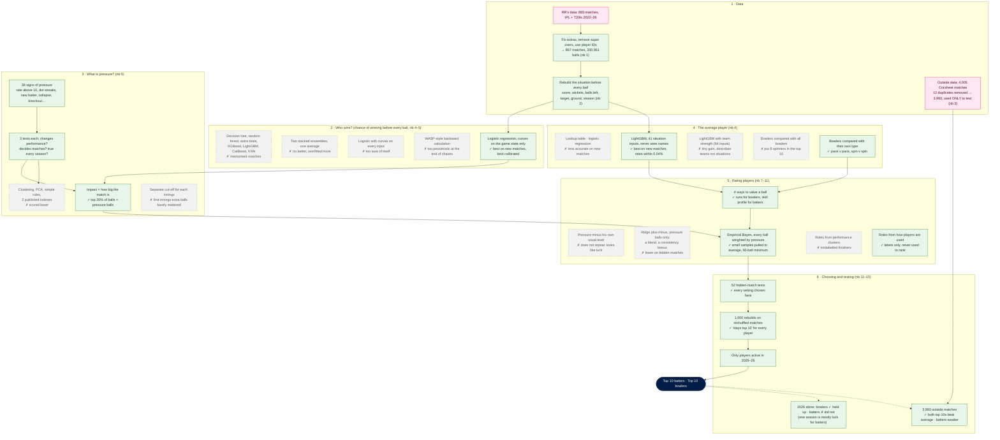

# How this was built: everything tried, kept and dropped

One map of the whole project, in plain words. **Green** = kept. **Grey** = tried and dropped, with the reason.
Each box names the notebook where it happens.

## The same story in seven lines

1. **Clean the data.** Fix extras, drop super overs, use player IDs: 867 matches, 200,961 balls.
2. **Predict who wins before every ball.** 11 models were tried. The simple logistic regression won, because the others memorised matches.
3. **Define pressure.** 38 signs, 3 tests, 8 definitions. Impact × how big the match is won. The top 20% of balls are pressure balls.
4. **Learn the average player.** LightGBM, never seeing names. Bowlers are only compared with their own type.
5. **Rate players.** Every ball counts, pressure balls count most, and small samples are pulled to average. "Rising above your own level" was tested and dropped, because it looked like luck.
6. **Choose and test.** 52 hidden-match tests, 1,000 rebuilds, the 2026 season and 3,993 outside matches.
7. **Answer.** Top 10 batters and bowlers, active players only.
